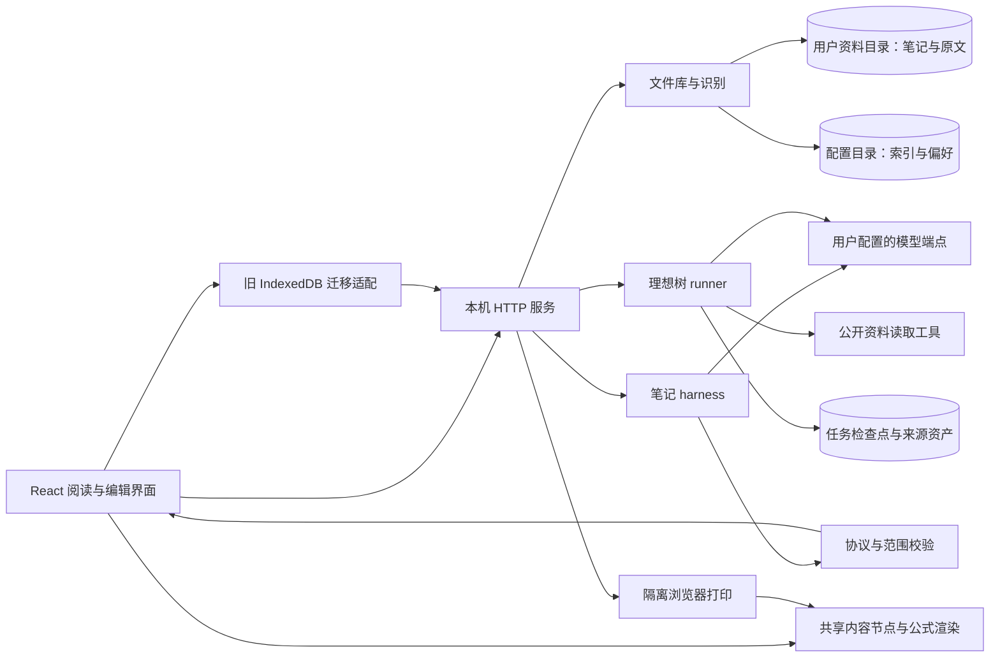
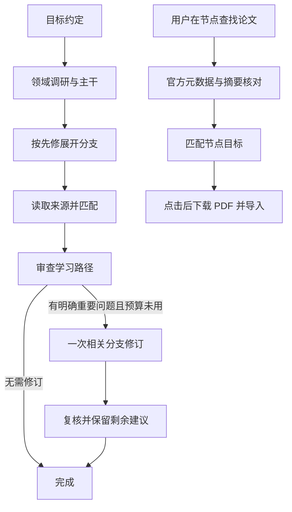

# 架构与数据流

当前架构服务于本机单用户学习空间。浏览器承载交互，Node 服务负责文件持久化、模型适配、来源读取、理想树后台任务和 PDF 导出。核心文档规则放在共享模块，前后端均可校验。

桌面版在 Electron 内使用相同 UI 与服务：renderer 禁用 Node、启用 sandbox/context isolation，通过私有 `pangzhu://app` 来源访问仅监听回环地址的随机端口服务。模型配置在 `%APPDATA%/PangzhuNotes/.env`；该目录还保存轻量资料索引、画像、模板和偏好。开发版分别使用项目 `.env` 和 `.local-storage`，不继承桌面版凭据或画像。

笔记与原文保存在用户选择的资料目录，默认是系统文档目录下的“烛光笔记”。每份资料的文件夹保存 `note.candlelight.json` 和配套原文；目录资料首次保存时也复制原始 PDF，避免另一安装版本只能找到笔记。旧版仅引用目录原文的记录会在原文仍可读取时补齐副本，不改笔记正文。JSON 笔记备份不被当作 PDF，缺少原件会明确显示。旧 IndexedDB 内容在逐份落盘并校验后迁移。

更改下次导入目录不自动搬移已有文件；显式“迁移现有资料”先预览已管理文件和缺失项，再复制到独立空目录，逐文件校验 SHA-256 后通过持久日志提交新路径，最后在写锁和摘要检查下清理旧副本。包括回收记录、`.candlelight/ideal-trees` 检查点与资产、生成记录；不搬用户最初导入的外部原件，不复制 Key。提交前中断回退，提交意图落盘后可继续完成；其他应用新改的旧文件保留并报告。迁移后轮换空间令牌并刷新界面，拒绝旧窗口写入。其他安装版本如仍关联旧位置，需重新识别新目录。

启动时和“识别已有笔记”可将目录中有效的笔记关联到本应用索引，保留各阅读版本及纸条，不调用模型，不复制文件。重复编号和移动的记录需要按识别结果处理；原文缺失时可只读打开已有正文。多应用共用文件的写入及删除通过文件锁和读取摘要检查，拒绝过时操作，不提供实时合并。完整备份需在正常退出后同时保留配置目录、所有实际资料目录及树资产；只复制 AppData 或导出单篇笔记均不等于完整备份。

桌面退出先确认活动任务，暂停模型/树任务并等待检查点，然后请求 renderer 完成笔记落盘、刷新存储并关闭服务。保存失败时保留窗口。浏览器开发版关闭标签页不等于关闭后台服务；桌面版正常退出会一并停止服务。

## 一次笔记协作

1. UI 保存当前笔记版本、修订号、选区/锚点和允许修改的范围。
2. `server/harness.mjs` 收集相关原文和周围笔记；学习目标、稳定画像、模板快照分别进入约定字段。纯翻译不使用画像。
3. 模型按动作返回内容。服务校验结构、ID、引用和公式，编译为 `reading-tree-note-v1` 节点。
4. 建议供用户检查；客户端在提交时再次核对笔记身份和修订号。等待期间的用户编辑不会被迟到响应覆盖。
5. `shared/document.mjs` 执行受限修改，纸条属于正文树。`shared/notebooks.mjs` 保存版本及历史，`src/storage.ts` 经认证 API 请求 `server/file-library.mjs` 原子写入笔记文件。IndexedDB 保留旧数据迁移及明确关闭文件存储时的兼容适配。

模板在首次生成前保存快照：未来设置变化不应悄悄改变同一份笔记的后半部分。画像调整必要解释的深度，文风来自模板；生成后的内容不会因用户切换画像而自动重写。

`shared/adaptive-evidence.mjs` 保留一次未采用的写作契约候选：在 [单项对照](../evals/notes/runs/2026-10-18-evidence-plan.md) 中约束来源的论证强度和教学补充条件。真实输出仍有过度确定的解释，课件还出现过度概括，因此应用已撤回该后缀。模块只由评测导入，可按原消息重放；它不是另一次 AI 审稿，也没有新增语义拒绝器。

## 一次理想树构建

`server/ideal-tree/runner.mjs` 保存每个已接受阶段。浏览器关闭后构建继续；服务中断后需要用户明确续接。资料检索状态与课程内容分开：资料暂缺不会无限触发整棵树内容修订。单节点论文查找不重新审查或生成学习路径。

工具对公开地址、DNS、跳转、大小和耗时设置边界。模型给出的论文编号只是候选，必须实际查询；真实摘录编号由程序产生，模型不能创造来源 ID。规则详见 [理想树契约](../server/ideal-tree/README.md)。

## 文件入口

| 关注点 | 主要入口 |
| --- | --- |
| HTTP 认证、配置、请求生命周期 | `server/index.mjs` |
| 笔记请求和模型适配 | `server/harness.mjs` |
| 两套模板、样稿与快照 | `shared/writing-templates.mjs`、`server/template-harness.mjs` |
| 文档修改、笔记版本 | `shared/document.mjs`、`shared/notebooks.mjs` |
| 统一公式和 Markdown | `shared/note-format.mjs`、`shared/note-html.mjs` |
| 理想树持久任务 | `server/ideal-tree/runner.mjs` |
| arXiv 节点研究 | `server/ideal-tree/node-papers.mjs`、`arxiv.mjs` |
| 多源独立笔记 | `shared/bundle-context.mjs`、`server/harness.mjs`、`shared/preparation.mjs`；范围快照、规划覆盖与逐章提交，见 [契约](bundle-notes.md) |
| 人工审定课程实验 | `server/course-harness.mjs`；使用人工核对的主题清单，与产品自动来源规划分开 |
| 条件与量词复核实验 | `server/claim-review.mjs`、`evals/claims/`；仅候选预览，未接入应用 |
| 主张级复核与受限算术 | `server/claim-audit.mjs`、`server/claim-arithmetic.mjs`；实验 v2，不自动认证语义 |
| 存储适配、文件库与目录识别 | `src/storage.ts`、`server/file-library.mjs`、`server/file-discovery.mjs` |
| 完整空间备份、状态恢复日志 | `server/workspace-backup.mjs`、`server/workspace-state.mjs`；[范围与边界](workspace-recovery.md) |
| 生成快照与实际调用追溯 | `server/generation-records.mjs`；不包含连接凭据，不自动认证教学质量 |
| PDF 打印 | `server/pdf-export.mjs`、`server/print-document.mjs` |

## 主要取舍

| 决策 | 收益 | 当前代价 |
| --- | --- | --- |
| 本机服务 + 可选择目录的文件库 | 重装和多安装可识别已有笔记，用户可管理文件 | 配置与资料分离，备份需覆盖所有目录；共享文件冲突需人工处理 |
| 原文、画像、目标、模板分别约束 | 输出来源和风格职责清楚 | 上下文需要显式组织与验证 |
| 结构化返回后提交 | 可校验范围、版本和来源 | 等待完整返回，当前不是 token 流式界面 |
| 分阶段检查点与有限修复 | 故障后可续接、成本有边界 | 接受保留缺口和建议，不能承诺自动完成一切 |
| 共用内容节点与渲染 | 减少纸条、正文、导出差异 | 需维护来源格式兼容，不能恢复已丢失的原始数学结构 |

这些是当前代码的事实和取舍。多用户账户、云同步、分布式任务和跨设备协作尚未实现，架构图不隐含这些能力。

## 诊断与局部修订实验

`server/claim-review.mjs` 使用独立快照和模型适配器，流程是“目标段及来源 → 模型诊断 → 引文与范围校验 → 局部候选 → 同版本预览”。`server/model-budget.mjs` 在实际供应商边界计入重试，正文评测与该实验共用预算实现。应用入口没有调用此组件。

结构拒绝、语义漏检与产品策略分歧分别记录。[首轮结果](../evals/claims/runs/2026-10-18/README.md) 表明：即使原句和来源逐字匹配，模型仍可能偷偷补上前提；缺证据也可能被当成反证。当前返回值标为 `model-proposal-unverified`，不能当作自动审定或自动修正文稿的依据。

[v2](../evals/claims/v2/README.md) 使用原文范围编号支持段内多个主张，将来源不足与明确反证分成不同结构。程序按引用出处决定修订、补条件或停止，撤回无依据保证必须由调用方显式启用。算术运算树只允许固定操作和有限大小的有理数，不执行模型代码；来源映射与变量取值条件仍未自动验证。真实对照中暴露的角色混淆使它尚不适合全量自动复核。

`server/calculation-review.mjs` 是另一项实验：笔记文字 → 原句锚定的计算解释／直觉／含义未明 → 冻结中间结果 → 允许来源上的规则比较 → 只读诊断。第一阶段不接收来源正文，第二阶段不能修改已记录的解释。引文和覆盖校验失败会停止当前候选，已经接受的解释仍保留以便定位。模型把文字转成公式是否忠实，以及来源公式是否适用，属于尚待评估的语义层；表达式只作展示，程序不会执行。这不是应用默认生成流程。

[成立条件实验](../evals/claims/focused/README.md) 的 `server/condition-review.mjs` 复用文字定位，将模型职责收缩为四种逐句诊断，去掉断言复述与强制前提清单。只校验覆盖与引用，不从“推导依据仅在来源中”自动推断需要补条件。独立实验执行器将两组都限制为一次诊断请求，没有编辑接口，原有协议和历史记录保持原样。

`evals/claims/field/` 在该协议外增加真实生成产物的完整窗口规划、逐句覆盖和人工审阅记录。调用生产生成器后再规划全部窗口；一批失败不会改成保留或吞掉后续文本。审阅记录区分展开前判断和后续修改，模型结果缺失单列；独立性仅由审阅者声明，不由代码认证。组件仍与应用提交路径隔离。
