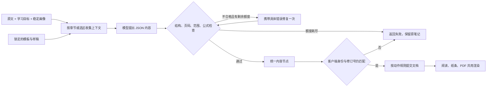

# 项目展示与复现路线

烛光笔记把论文、课件和讲义变成可编辑的学习笔记。核心工程问题是：模型产物怎样带着明确的来源、编辑范围和版本约束进入文档，失败时怎样恢复，以及如何验证讲解是否真的有帮助。

这是已可运行的本地单用户项目，使用 React、TypeScript、Tiptap、PDF.js、Node.js 和可配置模型端点。默认接入 DeepSeek；不声明已经达到多租户生产服务或自动教学质量认证的水平。

## 十分钟展示

先完成 README 的安装步骤。以下演示不需要 Key；实际模型生成只在另行授权的真实对照中发生。

| 时间 | 展示 | 能说明的工程能力 |
| --- | --- | --- |
| 0–2 分钟 | `npm run dev`，打开内置原创 Attention 示例，滚动笔记与原文，查看段落间纸条 | 连续阅读空间、统一内容节点、编辑与来源定位；注明这是已有示例而非现场生成 |
| 2–4 分钟 | 说明选区、锚点、笔记身份与修订号，打开下方数据流及对应代码 | 上下文职责与提交边界，不把用户编辑直接交给模型覆盖 |
| 4–6 分钟 | `npm run demo:harness`，按 `examples/harness/README.md` 查看中断、续接和无效来源拒绝 | 模拟供应商驱动真实 runner；已完成工作保留、失败可定位、修复有界 |
| 6–8 分钟 | 零调用重建已归档三场景审阅页，读一份纸条及其原文，再查看失败与用量 | 能对模型产物作有证据的开发诊断；不将格式接受率包装成教学质量胜率 |
| 8–10 分钟 | 展示本机 `artifacts/check/report.json`、测试分层、当前限制与下一项待验收问题 | 可复现验收、诚实的证据边界及有依据的迭代决策 |

重建已保存结果：

```sh
npm run eval:notes -- --inspect evals/notes/runs/2026-10-18-product/run.json --out artifacts/showcase-product-review
```

打开生成目录的 `review.html`。目标目录已存在时换新目录，不覆盖历史证据；该命令不读取模型 Key、不产生模型调用。独立审阅者先看匿名页，完成后才看私有方法映射；若已看过本报告中的方法和问题，可以做开发反馈，但不称为独立盲评。

另可运行 `node scripts/render-product-reference.mjs` 查看 `artifacts/product-reference/reference.html`：这是带原文和修订依据的 AI 编辑样稿，用来讨论阅读效果，不冒充模型直接生成或人工认可的标准答案。对应 [候选撤回记录](../evals/notes/runs/2026-10-18-evidence/README.md) 展示了一次有明确采用边界的提示迭代。

## 一条生成链路



模型的“解释正确”不属于结构校验器能够保证的结果。`adaptive-evidence-v1` 曾作为具体约束原文论证强度和教学补充条件的候选；真实对照未达到本轮预定要求，已从生产撤回，仅保留评测重放。展示这次决策时应同时展示控制组、残留问题及代价，不把增加了规则当成已经改善质量。

局部协作建议先预览，再由用户点击“写入笔记”；首次全文整理按其生成流程保存。两者不能混称为每次生成都需要人工确认。

| 问题 | 代码证据 | 如何验证 |
| --- | --- | --- |
| 画像为什么不改变文风？ | `shared/learning.mjs`、`shared/writing-templates.mjs` | 固定模板快照；稳定画像只决定铺垫，学习树不自动充当已掌握知识 |
| 局部追问怎样得到上下文？ | `server/harness.mjs#buildMessages` | 来源、已有笔记、selection、anchorId 与 learningIntent 分开传入；原文是数据 |
| 已有笔记为什么不会被旧响应覆盖？ | `shared/document.mjs#applyResult`、`shared/notebooks.mjs` | 修订号与笔记身份、编辑范围和版本历史的行为测试 |
| 长文截断与坏 JSON 怎么处理？ | `server/harness.mjs#runModel` | 按来源分段、完整验证后返回；截断结果丢弃，结构修复次数有限 |
| 调用预算算在哪里？ | `server/model-budget.mjs` | 评测在实际 fetch 边界计入每次请求，截断重试和格式修复也占额度；不暗示所有产品入口共享同一全局预算 |
| 公式为什么能统一显示？ | `shared/note-format.mjs`、`shared/note-html.mjs`、`server/print-document.mjs` | 解析为共享节点，纸条、正文及打印复用；公式能渲染仍不代表公式正确 |
| 提示改动如何比较？ | `evals/notes/experiment.mjs`、`tests/adaptive-evidence.test.mjs` | 冻结输入与预算，改前提示逐项匹配真实归档，保留失败和原始响应 |

## 可用于项目介绍的表述

> 开发本地 AI 学习笔记应用，将论文和课件整理为可编辑长文及行内讲解。实现模板快照、稳定画像与学习目标约束，使用结构化编辑协议、修订号检查、来源定位和有界修复保护文档。为真实模型输出建立可重放的对照评测，分别记录交付、内容问题和成本，并保留失败实验。

技术讨论时用具体故事补充：一次延迟响应如何被阻止覆盖新编辑；为什么选择保持原稿并报告失败；一条证据约束与同样的生产流程怎样作对照。介绍本人承担的部分时，应按实际参与补充设计决策、代码审查和 AI 协作方式，不把自动生成或未亲自掌握的部分写成独立完成。

## 已验证与未验证

| 可以展示的证据 | 目前不能据此声称 |
| --- | --- |
| 本机 `check` 的阶段结果与浏览器截图 | 远程 Windows/Linux CI 已通过，除非实际推送并观察其运行 |
| 三场景原始请求、响应、失败与用量 | 对所有论文有效，或相比基础模型有确定的学习效果优势 |
| 模拟故障恢复、编辑与导出回归 | 模拟文本达到真实模型的教学质量 |
| 无效来源标识及越界编辑被拒绝 | 引文一定支持段落、模型推理已自动认证 |
| 嵌套资料包、独立笔记规划与逐章恢复；另有人工审定课程实验 harness | 自动覆盖规划已证明讲义完整、练习答案正确或难度合适 |

自动数学复核实验保持冻结，原因与负面结果见 [两阶段复核记录](../evals/claims/runs/2026-10-18-calculation/README.md)。v0.1.0 固定本地产品流程、harness 执行边界、评测重放和展示材料；进一步的阅读体验与独立内容审阅属于后续迭代，详见 [版本收束边界](engineering.md#v010-的收束边界)。不能把测试数量、提示长度或协议层数当成护城河的证明。

发布前仍需作者决定代码许可证，并分别核对示例资料与论文选段的再分发权利。模型 Key、私人 PDF、个人笔记和本机数据不进入展示包。此文件是本地项目说明，本轮没有推送或发布网站。
