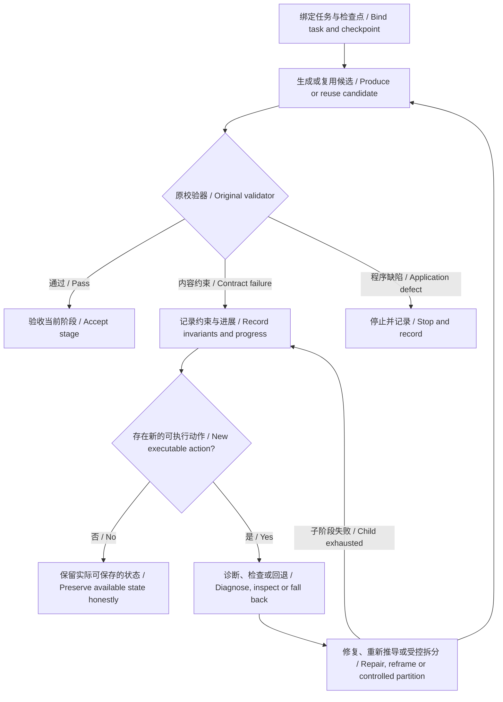

# 恢复执行评测 / Recovery execution evaluation

此评测验证应用在一次操作内如何处理失败。它使用原创合成任务和确定性模型替身，不读取私人资料、不加载 `.env`、不联网。通过表示执行契约满足，不代表真实模型具有同样的成功率。

This evaluation tests failure handling within one operation. Original synthetic tasks and deterministic model doubles use no private materials, `.env`, network or live models. Passing verifies execution contracts, not real-model success rates.

另有 [真实模型修复工作区评测](agent-evidence.md)：记录了实际失败推动实现修改的过程，提供显式启用真实 API 的原创案例入口，与本页的离线替身评测分别统计。

A separate [live recovery-workbench assessment](agent-evidence.md) records implementation changes driven by actual failures and provides original cases with explicit live-API opt-in. Its results are separate from the offline doubles described here.

```sh
npm run eval:recovery
npm run eval:recovery -- --out artifacts/my-recovery-check
```

报告位于 `artifacts/recovery-eval/report.json`。每个案例同时检查是否交付正确结果、调用次数、策略切换和未验收内容的隔离。需要停止的案例也必须符合具体原因，例如取消或认证失败；不能仅以“没有崩溃”算通过。`npm run check` 自动运行此评测并收录日志与源码指纹。

The default report is `artifacts/recovery-eval/report.json`. Cases check accepted output, call counts, strategy changes and isolation of rejected results. Expected stops must match their cause, such as cancellation or authentication failure; merely avoiding a crash is insufficient. `npm run check` includes this evaluation, logs and source fingerprints.

## 执行设计 / Execution design



模型负责解释实际失败并提出恢复计划；程序负责可执行方法、状态和验收权。产品不设隐含调用或修订次数上限；下表的预算边界案例由评测显式注入限制，验证独立测试不会突破授权范围。错误信息与失败输出都是数据，不能改变工具权限或原约束。独立传输与存储层处理网络暂时故障和文件锁；内容层处理答案是否满足任务，避免把环境错误反复发给模型。

The model diagnoses evidence and proposes recovery. The application owns permitted actions, state and acceptance. Production has no implicit call or revision quotas; budget-boundary cases below explicitly inject evaluation limits to verify authorized test scope. Error text and rejected output are data, never tool permissions or replacement constraints. Separate transport and storage layers handle temporary network failures and locks; the content layer handles task validity.

| 场景 / Scenario | 预期 / Expected |
| --- | --- |
| 同一错误只改措辞 / Cosmetic churn | 换策略并通过 / Change strategy and accept |
| 仅余一次调用 / Last action call | 留给修复 / Spend on repair |
| 诊断网络重试 / Diagnostic transport retry | 保留最后执行额度 / Preserve the action reservation |
| 校验器程序缺陷 / Validator defect | 一次生成后停止，不让模型修程序 / Stop without content retries |
| 拆分子步骤无进展 / Child makes no progress | 父阶段换策略，整体再验收 / Parent recovers and validates aggregate |
| 检查点保存失败 / Checkpoint unavailable | 不谎称已持久保存 / No false durability claim |
| 拆分中的认证、取消、总额度 / Auth, cancellation, global budget in child | 分别正确传播 / Propagate each boundary |
| 检查点损坏 / Corrupt checkpoint | 重新校验修复 / Revalidate and repair |
| 真正消除部分问题 / Actual partial progress | 允许继续定向修复 / Permit further targeted repair |
| 同字段未覆盖目标减少 / Fewer unresolved targets in one field | 按数量识别进展，单纯替换目标名称不算 / Recognize reduced count, not renamed targets |
| 修复中取消 / Cancel during repair | 不再请求 / No further request |
| 无效认证 / Invalid credentials | 无正文修复 / No content repair |
| 传输失败叠加无效 JSON / Transport plus invalid JSON | 一次操作、共享预算 / Recover under one shared budget |
| 过期或越权计划 / Invalid controller plan | 有限回退 / Bounded fallback |
| 已完成阶段复用 / Accepted-stage reuse | 不重跑正文 / No regeneration |
| 持续无进展 / Persistent invariant failure | 有限停止，不交付坏内容 / Bounded stop, no invalid delivery |

2026-10-21 的原实现基线为 12 个案例，6 个失败：措辞变化、末次调用分配、校验器缺陷、子阶段失败传播、保存状态误报和持续无进展。基线与修复后报告分别保存在本机 `artifacts/recovery-audit/before/report.json`、`artifacts/recovery-audit/final/report.json`。增加的 6 个边界案例不混入旧基线的分母。没有把旧真实模型实验当成本轮结果。

The 2026-10-21 baseline contained 12 cases with six failures: cosmetic churn, last-call allocation, validator defects, child failure propagation, false durability and persistent non-progress. Local before/after evidence is in `artifacts/recovery-audit/before/report.json` and `artifacts/recovery-audit/final/report.json`. Six added boundary cases are not included in the old baseline denominator. Previous live-model experiments are not presented as evidence for this round.

## 评测边界 / Limits

替身故意制造错误和响应策略变化，用来检验调度机制。它不能验证模型是否能独立识别所有新错误，也不能证明讲解质量。真实模型对照需要另外固定资料、任务、模型版本和预算；后续可从真实使用失败中脱敏提取案例，并在进入回归集之前人工确认验收条件。已有内容、引用和数学校验不会因这些执行测试通过而放宽。

The doubles deliberately generate failures and react to strategies to test orchestration. They cannot establish autonomous diagnosis of arbitrary new failures or teaching quality. Live comparisons require separately fixed materials, tasks, model versions and budgets. Future field failures can become anonymized regression cases after their acceptance conditions are reviewed. These tests never relax existing content, citation or mathematics checks.
